<div align="center">


# SIGEA

**Sistema Integrado de Gestión de Evidencias para la Acreditación**

Centraliza, organiza y protege las evidencias de cada factor CNA en un solo lugar.


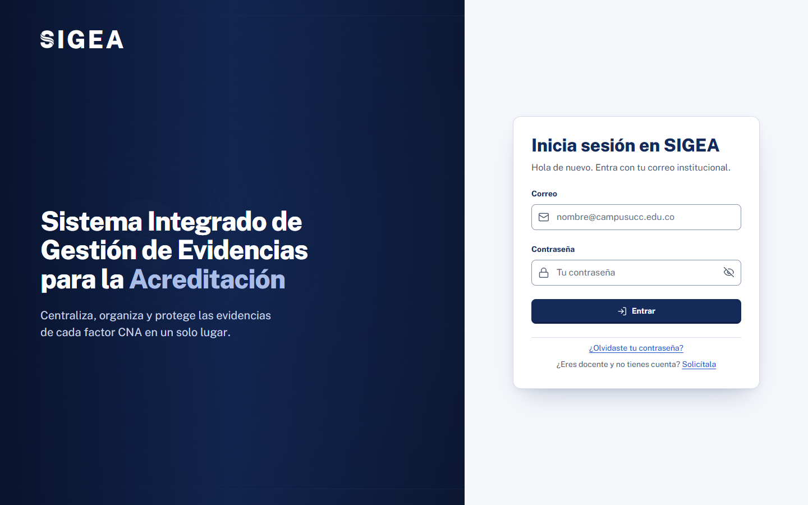

[El problema](#-el-problema) · [La solución](#-la-solución) · [Cómo funciona](#-cómo-funciona) · [Pantallas](#-pantallas) · [Seguridad](#-seguridad) · [Instalación](#-instalación) · [Arquitectura](#-arquitectura)

</div>

---

## 🎯 El problema

Para la **acreditación de alta calidad**, una facultad debe demostrar ante el CNA (Consejo Nacional de Acreditación de Colombia) que cumple con **12 factores** de calidad. Cada factor se sustenta con evidencias: actas, informes, planes, hojas de cálculo y presentaciones.

En la práctica esas evidencias viven repartidas:

| Síntoma | Consecuencia |
|---|---|
| 📂 Archivos sueltos en correos, carpetas personales y unidades compartidas | Nadie sabe cuántas evidencias hay por factor ni cuánto falta |
| 🔁 Versiones duplicadas ("final", "final2", "definitivo") | Se presenta un documento desactualizado al par evaluador |
| 🔓 Documentos sensibles (salarios, evaluaciones) sin control de acceso | Riesgo de exposición de información confidencial |
| 🕳️ Sin trazabilidad de quién subió, aprobó o descargó qué | No hay forma de responder ante una auditoría |
| ⏳ Revisiones que se quedan esperando semanas | La acreditación se retrasa al final del proceso |

## 💡 La solución

SIGEA convierte esa dispersión en un **expediente vivo de acreditación**. Cada evidencia queda ligada a su factor CNA, pasa por revisión, conserva sus versiones y deja rastro de cada acción.

<table>
<tr>
<td width="33%" valign="top">

### 📊 Avance medible
La **matriz de autoevaluación** cruza los 12 factores con cada programa y compara las evidencias aprobadas con la meta, usando la escala de gradación CNA.

</td>
<td width="33%" valign="top">

### ✅ Revisión con controles
Las evidencias pasan por una **cola ordenada por antigüedad**. Nadie aprueba lo que subió, y editar una evidencia aprobada la devuelve a revisión.

</td>
<td width="33%" valign="top">

### 🔐 Acceso Zero-Trust
Cada rol ve solo lo que le corresponde. Para ver un **documento sensible** hacen falta los votos de dos personas: el autor, la Coordinadora o la Decana.

</td>
</tr>
<tr>
<td valign="top">

### 🗂️ Versionado
Cada corrección es una versión nueva. El original se conserva y cualquier versión se puede restaurar.

</td>
<td valign="top">

### 🧾 Auditoría completa
Inicios de sesión, descargas, aprobaciones, accesos denegados y cambios de usuarios quedan registrados con su IP real.

</td>
<td valign="top">

### 🔎 Búsqueda útil
Se busca por título, factor, programa, estado y fechas. Cada archivo se identifica a simple vista por su tipo: PDF, Word, Excel o PowerPoint.

</td>
</tr>
</table>

## ⚙️ Cómo funciona

### Tres roles, tres paneles

| Rol | Qué hace | Qué ve en su panel |
|---|---|---|
| 👩‍💼 **Decana** | Dirige la acreditación de la facultad y gestiona usuarios | Avance global, matriz factor × programa, cola de revisión y actividad de 30 días |
| 🧑‍💼 **Coordinadora** | Revisa y aprueba las evidencias de toda la facultad | Su cola de revisión, tiempos de revisión y avance de la facultad |
| 👨‍🏫 **Docente** | Sube evidencias y las corrige | Solo lo suyo: sus evidencias del último año, rechazos y avisos |

### Ciclo de vida de una evidencia

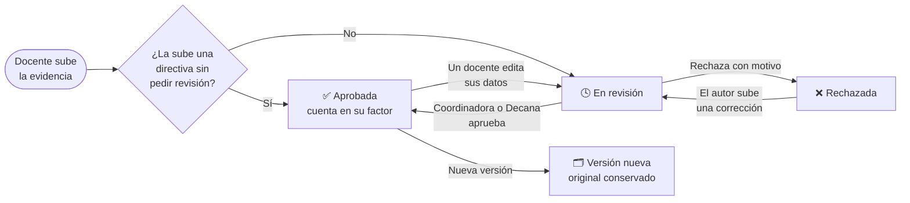

### Acceso a un documento sensible (Zero-Trust)

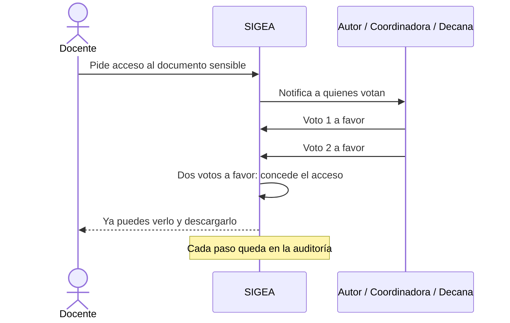

### Escala de gradación CNA

La matriz colorea cada factor según el porcentaje de evidencias aprobadas frente a la meta:

| Nivel | Rango | Lectura |
|:-:|:-:|---|
| 0 | 0 % | Sin evidencia |
| 1 | 1 – 59 % | No se cumple |
| 2 | 60 – 69 % | Insatisfactorio |
| 3 | 70 – 79 % | Aceptable |
| 4 | 80 – 89 % | Alto grado |
| 5 | 90 % o más | Pleno |

## 🖼️ Pantallas

<table>
<tr>
<td width="50%">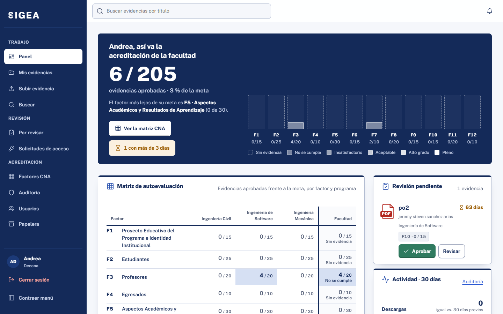<br><sub><b>Panel de la Decana:</b> huella de los 12 factores, matriz y cola</sub></td>
<td width="50%">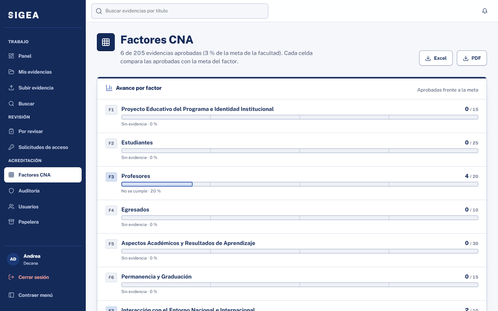<br><sub><b>Factores CNA:</b> avance de cada factor frente a su meta</sub></td>
</tr>
<tr>
<td>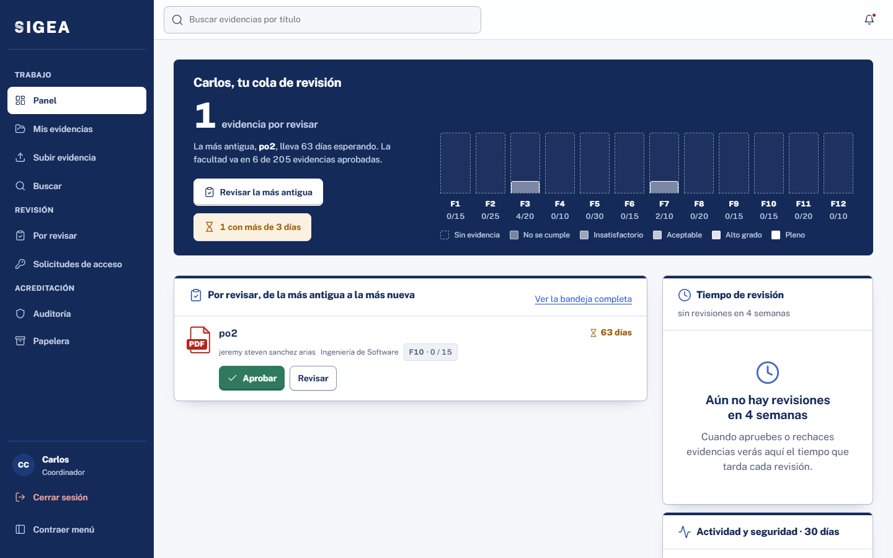<br><sub><b>Coordinadora:</b> cola de revisión ordenada por antigüedad</sub></td>
<td>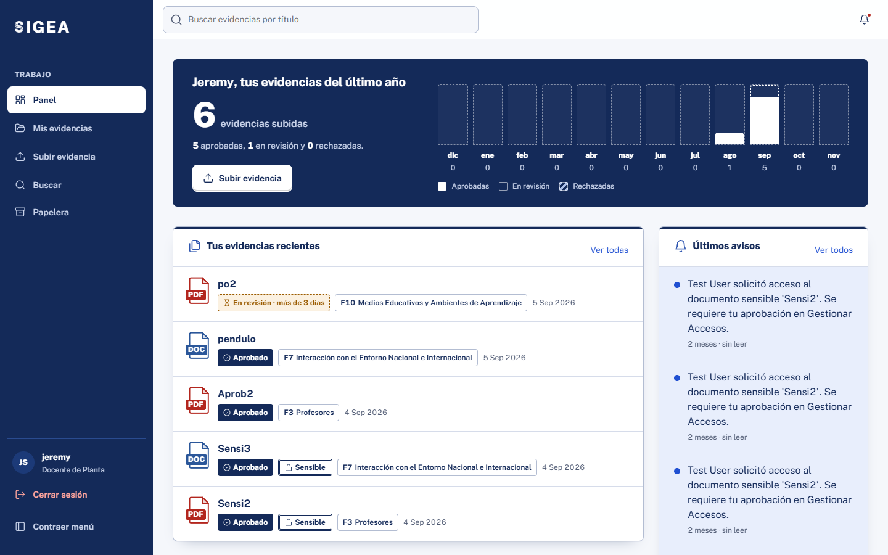<br><sub><b>Docente:</b> solo sus evidencias, sin datos de la facultad</sub></td>
</tr>
<tr>
<td>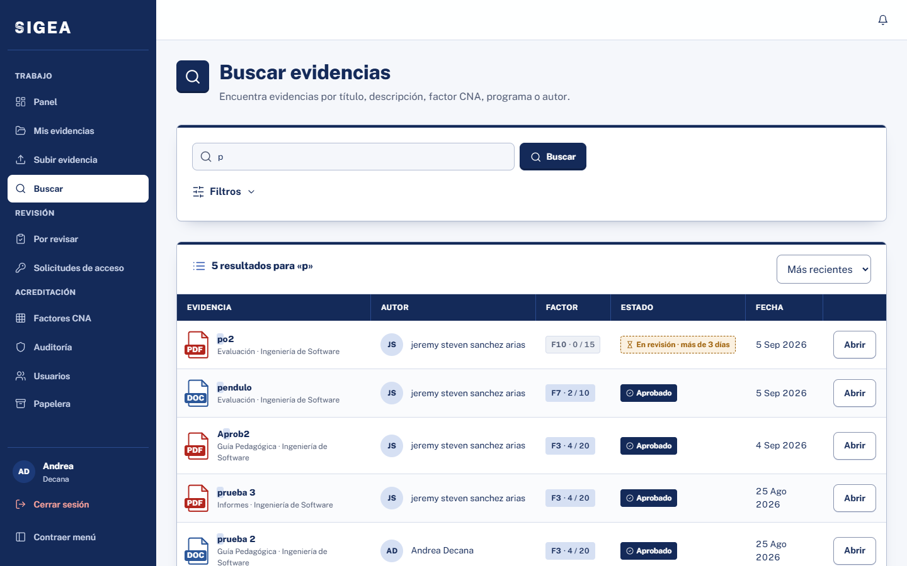<br><sub><b>Búsqueda:</b> tipo de archivo, factor y estado de un vistazo</sub></td>
<td>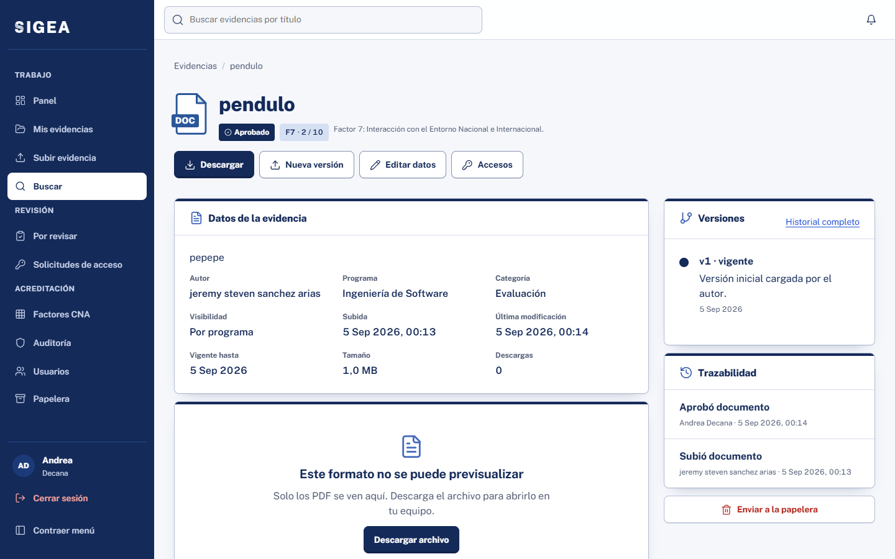<br><sub><b>Detalle:</b> datos, versiones y trazabilidad</sub></td>
</tr>
</table>

<details>
<summary><b>📱 Ver en móvil</b></summary>
<br>
<p align="center">
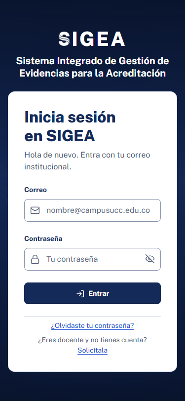
&nbsp;&nbsp;
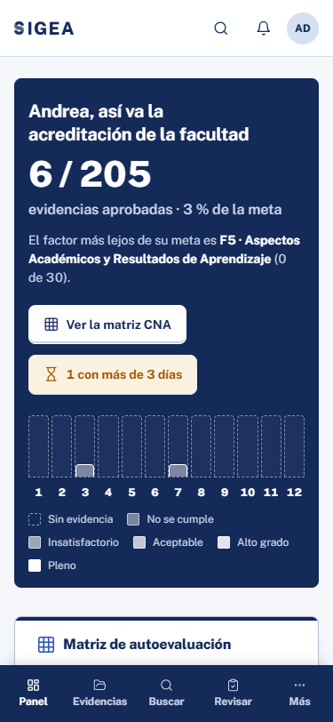
</p>
Todas las pantallas funcionan a 375 px: las tablas pasan a tarjetas, la navegación va abajo y las áreas táctiles miden 44 px.
</details>

## 🛡️ Seguridad

SIGEA pasó por una auditoría de seguridad completa y se corrigieron **todos** sus hallazgos: críticos, altos, medios y bajos. Las revisiones están documentadas en [`gestion_documental/informes/`](gestion_documental/informes/).

<details>
<summary><b>Ver los controles de seguridad</b></summary>
<br>

| Área | Control |
|---|---|
| Autenticación | Límite de intentos fallidos por IP y por cuenta (nadie puede bloquear a otra persona) y una sola política de contraseñas |
| Recuperación | Las mismas pantallas exista o no el correo (sin enumeración de usuarios) |
| Permisos | Control por rol en cada vista, más reglas Zero-Trust y votación para documentos sensibles |
| Revisión | Nadie aprueba lo propio; solo se decide sobre evidencias en revisión |
| Archivos | Validación de extensión, tamaño y firma real del contenido; descargas solo con permiso, sin rutas públicas a `media/` |
| Navegador | Content-Security-Policy (solo scripts propios), cookies seguras, HSTS y protección contra clickjacking |
| Datos | La app usa un usuario de base de datos sin privilegios de administración |
| Auditoría | Toda acción sensible queda registrada con la IP real del cliente |
| Errores | Mensajes genéricos al usuario y detalle solo en el log |

</details>

## 🚀 Instalación

<details>
<summary><b>Requisitos</b></summary>
<br>

- Python 3.12
- PostgreSQL 14 o superior
- Git

</details>

<details open>
<summary><b>Puesta en marcha local</b></summary>
<br>

```bash
git clone https://github.com/Jeremysa1/Docuflow-prototype.git
cd Docuflow-prototype/gestion_documental
```

```bash
python -m venv venv
```

```bash
./venv/Scripts/python.exe -m pip install -r requirements.txt
```

Copia `.env.example` como `.env` y completa los valores. En desarrollo pon `DEBUG=True`. Para crear el usuario `sigea_app` con permisos mínimos, sigue la sección M11 de [`informes/revision-seguridad-004-2026-11-07.md`](gestion_documental/informes/revision-seguridad-004-2026-11-07.md).

```bash
./venv/Scripts/python.exe manage.py migrate
```

```bash
./venv/Scripts/python.exe manage.py crear_datos_iniciales
```

```bash
./venv/Scripts/python.exe manage.py runserver
```

Abre http://localhost:8000. En Linux o macOS usa `venv/bin/python` en lugar de `./venv/Scripts/python.exe`.

</details>

<details>
<summary><b>Pruebas</b></summary>
<br>

```bash
./venv/Scripts/python.exe manage.py test tests
```

Son 109 pruebas: permisos, aprobación, votación Zero-Trust, versionado, auditoría, autenticación, riesgos de la auditoría, paneles por rol y reglas del sistema de diseño (sin estilos en línea, sin colores fuera de los tokens, sin textos menores de 12 px).

</details>

## 🏗️ Arquitectura

Monolito modular en Django, organizado por capas: vistas delgadas, una capa de servicios con la lógica de negocio y plantillas renderizadas en el servidor.

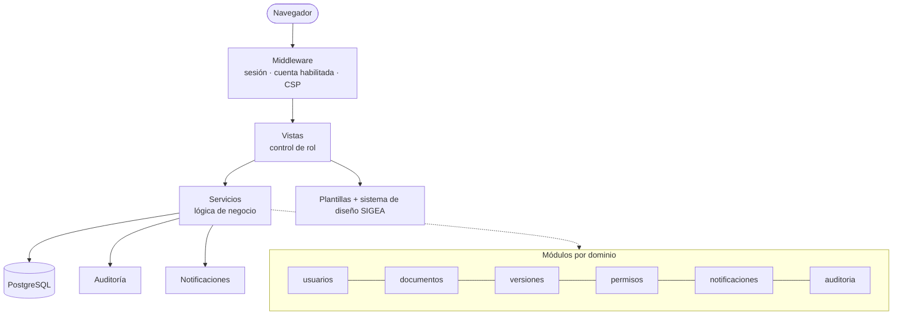

<details>
<summary><b>Estructura de carpetas</b></summary>
<br>

```text
Docuflow-prototype/
├── gestion_documental/          # Proyecto Django
│   ├── apps/                    # Un módulo por dominio
│   │   ├── usuarios/            # Autenticación, roles, invitaciones
│   │   ├── documentos/          # Evidencias, revisión, métricas CNA
│   │   ├── versiones/           # Historial y restauración
│   │   ├── permisos/            # Accesos y votación Zero-Trust
│   │   ├── notificaciones/
│   │   └── auditoria/
│   ├── core/                    # Middleware, decoradores, auditoría, validadores, template tags
│   ├── config/                  # settings, urls, admin (Unfold)
│   ├── templates/               # Shell, componentes y páginas de error
│   ├── static/css/sigea/        # Sistema de diseño en capas (tokens → páginas)
│   ├── tests/                   # Pruebas automatizadas
│   ├── scripts/qa/              # QA manual heredado
│   ├── documentacion/           # Manual técnico y referencias
│   └── informes/                # Revisiones de seguridad
├── specs/                       # Especificaciones (spec-kit) por funcionalidad
├── DESIGN.md                    # Sistema de diseño
└── PRODUCT.md                   # Contexto de producto
```

</details>

<details>
<summary><b>Stack</b></summary>
<br>

| Capa | Tecnología |
|---|---|
| Backend | Django 6.1, Python 3.12 |
| Base de datos | PostgreSQL (búsqueda con índices trigram) |
| Frontend | Plantillas Django, CSS propio con cascade layers, un solo archivo JavaScript sin framework |
| Tipografía e iconos | Public Sans y Lucide, servidos localmente |
| Admin | django-unfold con la paleta institucional |
| Exportación | openpyxl (Excel) y reportlab (PDF) |
| Estáticos | WhiteNoise con compresión Brotli |

</details>

## 📚 Documentación

| Documento | Contenido |
|---|---|
| [Manual técnico](gestion_documental/documentacion/manual_tecnico.md) | Módulos, modelos, reglas de negocio |
| [DESIGN.md](DESIGN.md) | Sistema de diseño: tokens, componentes, gradación |
| [specs/](specs/) | Especificación, plan y tareas de cada funcionalidad |
| [informes/](gestion_documental/informes/) | Auditoría y revisiones de seguridad |

---

<div align="center">
<sub>Hecho para la autoevaluación y acreditación de alta calidad · Facultad · 2026</sub>
</div>
